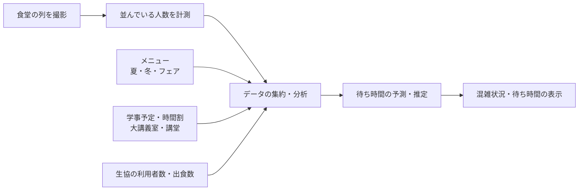

  

# FUNavi

**公立はこだて未来大学（FUN）の生協食堂の混雑状況と待ち時間を見える化するサービス**

> 🚧 本プロジェクトは高度ICT演習の新テーマとして準備中です。現在は事前活動（食堂の動画撮影・分析）の段階です。

---

## 目次

- [背景](#背景)
- [目指すこと](#目指すこと)
- [主な機能（予定）](#主な機能予定)
- [仕組み](#仕組み)
- [使用するデータ](#使用するデータ)
- [プライバシーへの配慮](#プライバシーへの配慮)
- [技術構成](#技術構成)
- [ロードマップ](#ロードマップ)
- [メンバー](#メンバー)
- [協力](#協力)

---

## 背景

未来大の生協食堂は、昼休みなど特定の時間帯に利用者が集中し、長い列ができます。

- 並んでいる時間が長く感じられる
- 列を見て、食堂の利用をやめてしまう人がいる
- 食堂のスペースや構造を変えるには、多くの費用と時間がかかる

そこで、**混雑の「集中」を分散させる**ことで、一人あたりの待ち時間（体感）を短くすることを目指します。

## 目指すこと

| 対象 | 得られること |
| --- | --- |
| 学生・教職員 | 空いている時間を知り、待たずに食事できる |
| 大学生協 | 利用の集中がやわらぎ、利用者の離脱を防げる |
| 大学生協（将来） | 出食数の予測を、仕入れの参考にできる |

## 主な機能（予定）

- **現在の混雑状況の表示**：食堂に並んでいる人数を表示
- **待ち時間の予測**：並んでいる人数や時間帯から、待ち時間を推定して表示
- **混雑しやすい時間帯の表示**：曜日・時間帯ごとの混み具合を表示
- **出食数の推定（将来）**：集めたデータから出食数を推定し、生協の仕入れを支援

## 仕組み

1. 食堂の列をカメラで撮影し、並んでいる人数と時間帯を記録します
2. メニュー、学事予定、講義の時間割、生協の利用者数・出食数と組み合わせて分析します
3. 分析結果から待ち時間を予測し、利用者に分かりやすく表示します

## 使用するデータ

| データ | 提供元 | 内容 |
| --- | --- | --- |
| 列の人数・時間帯 | 本プロジェクト（撮影） | 食堂に並んでいる人数の推移 |
| 利用者数 | 大学生協 | 時間帯ごとの利用者数 |
| メニュー | 大学生協 | 当月・当日のメニュー（フェアメニューは2〜3か月前、通常メニューは1か月前に決定） |
| 出食数 | 大学生協 | 品目ごとの出食数 |
| 学事予定・時間割 | 大学 | 大講義室・講堂の授業時間など |

## プライバシーへの配慮

撮影映像には利用者の顔が映る可能性があるため、以下のルールで取り扱います。

- 撮影データは **高度ICT演習の活動にのみ** 使用し、他の目的には使用しません
- データは大学のアカウントのクラウドストレージで管理し、関係者以外はアクセスできないようにします
- 保存期間は1年程度とし、期間終了後に削除します
- 撮影期間中は、食堂内で撮影していることを掲示します
- 撮影は大学生協および大学の許可を得たうえで行います

## 技術構成

> 現在検討中です。決まり次第更新します。

| 項目 | 内容 |
| --- | --- |
| 人数の計測 | 検討中（手作業で数える／物体検出で自動で数える） |
| バックエンド | 未定 |
| フロントエンド | 未定 |
| 表示方法 | 検討中（Webページ、食堂前のモニター、学内アプリへの掲載など） |

## ロードマップ

- [x] 大学生協との打ち合わせ・テーマ決定
- [x] 大学生協から撮影の許可を得る
- [ ] 大学（高度ICT演習事務局・教員）から撮影の許可を得る
- [ ] 事前撮影（2026年11月末頃から2週間程度）
- [ ] 撮影データの分析・人数の計測方法の決定
- [ ] 高度ICT演習テーマとして提案
- [ ] 待ち時間の予測・表示機能の開発
- [ ] 出食数の推定（将来）

## メンバー

| 名前 | 所属 |
| --- | --- |
| 永田 來煉 | 情報アーキテクチャ学科 3年（高度ICTコース） |
| 坂本 晴紀 | 複雑系知能学科 3年 |
| 後藤 優希 | 複雑系知能学科 3年 |

## 協力

- 公立はこだて未来大学 大学生協

---

  公立はこだて未来大学 高度ICT演習

